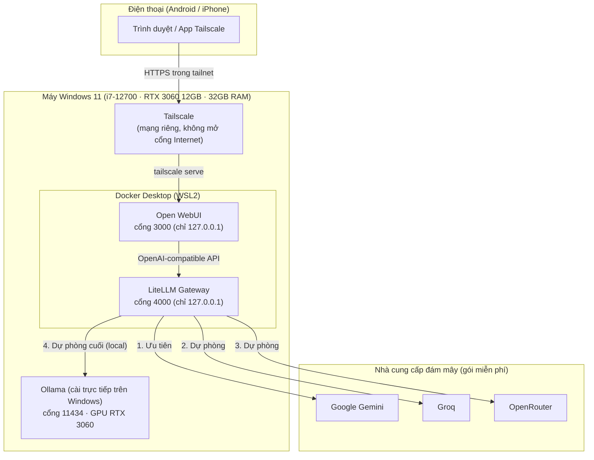
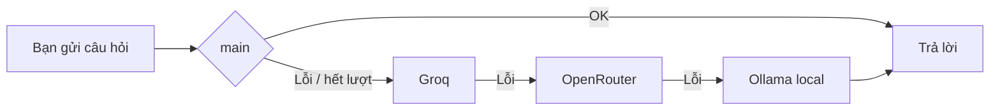

# Kiến trúc hệ thống (Phase 1)

## Ý tưởng chính

Bạn chỉ mở **một giao diện** (Open WebUI). Phía sau, hệ thống tự chọn model, tự chuyển model khi lỗi, và tự tận dụng gói miễn phí.

## Sơ đồ tổng quát

## Luồng failover (chuyển model tự động)

Tên `main` dùng Gemini làm model đầu tiên, sau đó Groq, OpenRouter, Ollama. Tên `code` dùng Ollama Qwen Coder trước để tiết kiệm lượt cloud, và chuyển sang cloud khi Ollama không chạy.

## Các thành phần

| Thành phần | Vai trò | Chạy ở đâu | Dữ liệu lưu ở đâu |
|---|---|---|---|
| Open WebUI | Giao diện chat, lịch sử, agent, memory | Docker | Volume `personal-ai-openwebui-data` |
| LiteLLM | Điều phối model, failover, retry, cooldown | Docker | Không lưu dữ liệu (cấu hình trong `infrastructure/litellm/config.yaml`) |
| Ollama | AI chạy trên máy, không tốn lượt | Windows (GPU) | `%USERPROFILE%\.ollama\models` |
| Tailscale | Mạng riêng mã hóa để truy cập từ điện thoại | Windows + điện thoại | Tài khoản Tailscale |
| Docker Desktop | Chạy container | Windows + WSL2 | Ổ đĩa WSL |

## Cách hệ thống quyết định (Phase 1)

Phase 1 dùng **chọn tay agent**. Bạn chọn Researcher, Coder, Writer hay Assistant trong Open WebUI. Mỗi agent là một model kèm hướng dẫn vai trò.

| Agent | Model gọi tới | Thứ tự ưu tiên |
|---|---|---|
| Researcher | `main` | Gemini → Groq → OpenRouter → Ollama |
| Writer | `main` | Gemini → Groq → OpenRouter → Ollama |
| Assistant | `main` | Gemini → Groq → OpenRouter → Ollama |
| Coder | `code` | Ollama Qwen Coder → OpenRouter → Groq → Gemini |

Lý do: `main` và `code` đã bao gồm failover. Bạn không cần đổi model khi một nhà cung cấp hết lượt.

## Những gì Phase 1 CHƯA làm

- **Tự nhận biết ý định** ("viết code" → Coder). Dự kiến Phase 2.
- **Quản lý quota theo số liệu.** Hiện chỉ đếm số lần bị giới hạn qua log (`health-check.ps1`).
- **Giám sát bằng Grafana/Prometheus.** Dự kiến Phase 1+ nếu cần.
- **Tìm kiếm tài liệu (RAG).** Dự kiến Phase 3.

## Điểm yếu cần biết
1. **Phụ thuộc một máy.** Tắt máy là mất toàn bộ dịch vụ, kể cả điện thoại không truy cập được.
2. **Gói miễn phí không ổn định.** Giới hạn có thể giảm, và tên model có thể đổi.
3. **Ollama `OLLAMA_HOST=0.0.0.0`** mở cổng trên mạng nội bộ. Cần tường lửa.
4. **Không có HTTPS nội bộ cho Ollama.** Chấp nhận được vì chỉ dùng trong máy và Docker.
